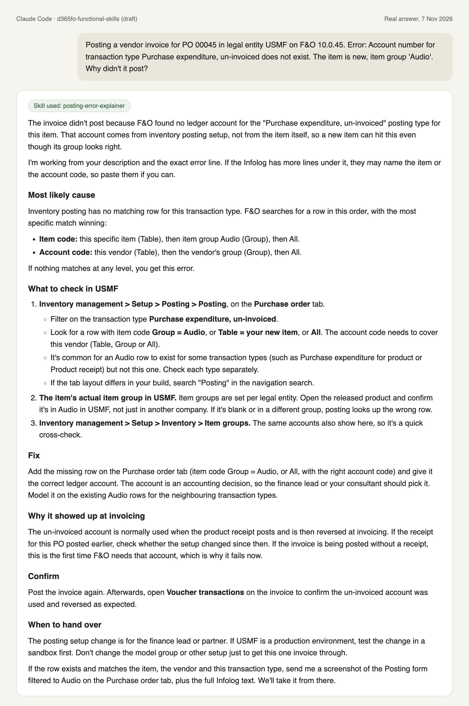

# D365 F&O functional skills

Free AI skills that help Dynamics 365 Finance and Supply Chain Management (F&O)
key users and functional consultants answer everyday questions: why a document
didn't post, which account it posts to, what a parameter does, and what steps a
setup task needs.

> **Status: draft.** Every skill is waiting for review by an experienced F&O
> consultant before its first release. Don't rely on the answers in production
> yet.

## What problem this solves

A key user gets a posting error, or wonders what a setting does. Often they
wait hours or days for a consultant to answer a question that has a standard
answer. The AI tools for F&O on GitHub today help developers write X++ code.
None help the people who run the business processes.

These skills teach an AI assistant (Claude, or a Copilot Studio agent) to
answer those questions the way a good consultant would:

- ask for the facts first: legal entity, module, F&O version, the exact error text
- check the most likely causes first, with the F&O menu path for each
- say who should make the fix, and to test setup changes in a sandbox
- hand over to a person when the question needs one

The skills need no access to any F&O environment. They only explain and point
to where to look; nothing is changed in F&O.

## What's inside

| Skill | The user says | The skill gives back |
|---|---|---|
| [posting-error-explainer](skills/posting-error-explainer/SKILL.md) | "Why didn't this post?" and pastes the error | What the error means, likely causes in order, where to check, how to fix |
| [posting-setup-explainer](skills/posting-setup-explainer/SKILL.md) | "Which account does this post to?" | The posting setup F&O uses, step by step, and how to check it |
| [parameter-guide](skills/parameter-guide/SKILL.md) | "What does this setting do?" | What it controls, the usual value, and what changes if you switch it |
| [key-user-checklists](skills/key-user-checklists/SKILL.md) | "Steps to set up a new legal entity for intercompany" | A short checklist in the right order, with menu paths |

Each skill folder has a `SKILL.md`, a `references/` folder with the detail, and
`test-questions.md` with sample questions and what a good answer must cover.

## Example

A real answer from Claude Code with the draft posting-error-explainer skill
installed:



## Install

**Claude (web or desktop app):** download the skill zips from Releases, then
Settings > Capabilities > Skills > Upload skill.

**Claude Code:**

```text
/plugin marketplace add DynAax-AB/dynaax-d365fo-functional-skills
/plugin install d365fo-functional-skills@d365fo-functional-skills
```

**Copilot Studio:** add the skill files to an agent as knowledge, and paste the
instructions from the install guide.

Full steps for each: [docs/install.md](docs/install.md).

## Accuracy

- Every skill is reviewed by an F&O consultant before release, and says which
  F&O version it was checked against.
- Menu paths and field names can move between versions. The skills tell the AI
  to say so when it isn't sure, and never to guess.
- The content is written from scratch. It links to
  [Microsoft Learn](https://learn.microsoft.com/en-us/dynamics365/) for the
  official documentation.
- This is a community project. It isn't affiliated with or endorsed by
  Microsoft.

Found a wrong answer? Please [open an issue](CONTRIBUTING.md#ways-to-help).

## Contributing

New skills and fixes are welcome. See [CONTRIBUTING.md](CONTRIBUTING.md) for
the writing rules, the skill template and the checks to run.

## Licence

[MIT](LICENSE). Free to use, change and share.
